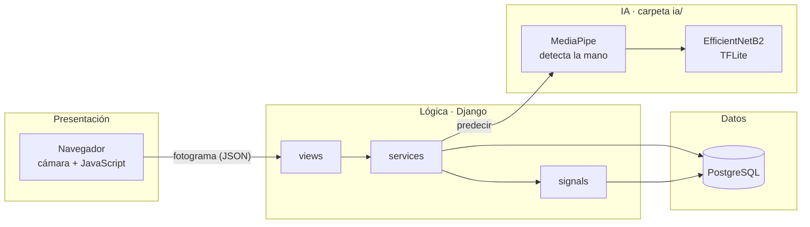

<div align="center">


# Net Bean

**Aprende lengua de señas practicando con tu cámara.**<br>
Una red neuronal convolucional evalúa tu seña al instante y te dice cómo mejorarla.

[](https://github.com/loliters/LSB---Netbean/actions/workflows/ci.yml)


[Funcionalidades](#-funcionalidades) · [Cómo funciona](#-cómo-funciona) · [Inicio rápido](#-inicio-rápido) · [Documentación](#-documentación) · [Equipo](#-equipo)

</div>

---

## 🤟 ¿Qué es Net Bean?

Sistema web de traducción de lenguaje de señas que funciona como **herramienta de enseñanza para personas oyentes**. El estudiante elige una seña, la hace frente a la cámara y el sistema responde con la letra o el número detectado, el porcentaje de coincidencia y orientación para corregir la postura. Cada acierto suma experiencia (XP), mantiene una racha diaria y desbloquea insignias.

Proyecto de **Proyecto de Sistemas I** · Universidad Privada del Valle · Ingeniería de Sistemas Informáticos · gestión 2-2026, desarrollado con la metodología **XP** (Extreme Programming).


## ✨ Funcionalidades

| Rol | Qué puede hacer |
|---|---|
| 🎓 **Estudiante** | Registrarse, iniciar sesión por correo y recuperar su contraseña · recorrer módulos (Alfabeto, Vocales, Números 1-5) · practicar con la cámara con retroalimentación guiada · ganar XP, racha, niveles e insignias · repasar sin XP las señas ya dominadas · ver su perfil y su avance |
| 👩‍🏫 **Profesor** | Elegir a qué estudiantes monitorea · **asignarles módulos, lecciones, letras o números** · ver su avance y quién lleva días sin practicar · gestionar el contenido · reportes en pantalla, Excel y PDF **solo de sus estudiantes** |
| 🛠️ **Administrador** | Gestionar usuarios (alta, edición y desactivación sin perder historial) · decidir qué estudiantes monitorea cada profesor · gestionar módulos, lecciones y señas con su imagen · ver métricas y reportes de todo el sistema |

## 🧠 Cómo funciona



```mermaid
sequenceDiagram
    actor E as Estudiante
    participant B as Navegador
    participant D as Django
    participant IA as Capa de IA
    participant DB as PostgreSQL
    E->>B: hace la seña frente a la cámara
    loop cada ~0,5 s
        B->>D: POST /reconocimiento/predecir/ (fotograma)
        D->>IA: recorta la mano y clasifica
        IA-->>D: letra y confianza
        D-->>B: porcentaje en vivo y consejos
    end
    Note over B: 70 % o más durante 2 s
    B->>D: POST /gamificacion/evaluar/
    D->>IA: vuelve a predecir (anti trampa)
    D->>DB: guarda la práctica; un Signal suma XP y racha
    D-->>B: resultado, XP y logros nuevos
```

- **Letras:** MediaPipe ubica la mano, se recorta un cuadrado de 1,3 veces su tamaño a 224 px y la CNN EfficientNetB2 (TensorFlow Lite) devuelve la letra y su confianza.
- **Números 1-5:** se cuentan los dedos extendidos con los 21 puntos de la mano; no necesita un modelo aparte.
- **Anti trampa:** el servidor vuelve a predecir antes de dar XP; el navegador solo muestra una vista previa.
- **Contenido por profesor:** si el estudiante no tiene asignaciones, ve todo el contenido; con una o más, ve solo lo asignado.

## 🧰 Tecnologías

| Capa | Herramientas |
|---|---|
| Backend | Python 3.12 · Django (ORM, Signals, vistas basadas en clases) |
| Base de datos | PostgreSQL · modelo relacional en 3FN con restricciones `PK`, `FK`, `UNIQUE` y `CHECK` · 20 tablas |
| Inteligencia artificial | TensorFlow Lite (EfficientNetB2) · MediaPipe HandLandmarker · OpenCV · NumPy |
| Frontend | Plantillas de Django · Bootstrap 5 · Bootstrap Icons · JavaScript ES6 · API MediaDevices · Chart.js |
| Reportes | openpyxl (Excel con gráficos) · ReportLab (PDF) |
| Calidad | pytest · pytest-django · GitHub Actions · Conventional Commits |

## 🚀 Inicio rápido

Requisitos: **Python 3.12** (con 3.13 o 3.14 no se instalan TensorFlow ni MediaPipe), **PostgreSQL**, Git y una cámara web.

```powershell
git clone https://github.com/loliters/LSB---Netbean.git
cd LSB---Netbean

py -3.12 -m venv venv
.\venv\Scripts\Activate.ps1            # Linux/macOS: source venv/bin/activate
pip install -r requirements/dev.txt

Copy-Item .env.example .env            # completa SECRET_KEY y las credenciales de PostgreSQL
createdb traductor_senas               # o créala desde pgAdmin

python manage.py migrate
python manage.py loaddata fixtures/catalogos.json
python manage.py cargar_alfabeto       # módulo Alfabeto con sus señas
python manage.py cargar_modulos        # módulos Vocales y Números 1-5
python manage.py cargar_logros         # insignias y niveles
python manage.py createsuperuser       # te pide el número (ID) del rol Administrador
python manage.py runserver
```

Abre <http://127.0.0.1:8000>. El modelo de IA y el detector de manos están en `ia/modelos/`; si faltan, sigue la [guía de integración del modelo](docs/manuales/MAN-ia-integracion-v2.md).

### Cuentas de demostración (solo para desarrollo)

| Rol | Correo | Contraseña | Cómo crearla |
|---|---|---|---|
| Estudiante | `estudiante.demo@netbean.com` | `Demo2026` | `python manage.py cargar_demo` |
| Profesor | `profesor.demo@netbean.com` | `Demo2026` | `python manage.py cargar_demo_profesor` |
| Administrador | el correo que registres | la que elijas | `python manage.py createsuperuser` |

> [!WARNING]
> Las cuentas demo no deben existir en producción. Para que el correo de «Olvidé mi contraseña» llegue de verdad hay que configurar SMTP en el `.env`; sin eso se imprime en la terminal (ver el [manual de instalación](docs/manuales/MAN-instalacion-v1.md#6-correo-de-recuperación-de-contraseña)).

## 🧪 Pruebas

```powershell
pytest                                   # más de 150 pruebas
pytest apps/usuarios                     # una sola app
pytest --cov=apps --cov=ia               # con cobertura (mínimo exigido: 70 %)
```

La integración continua ejecuta las pruebas en cada push y Pull Request con un PostgreSQL temporal. Las pruebas simulan el modelo de IA, por eso no necesitan TensorFlow.

## 🗂️ Estructura del proyecto

```
LSB---Netbean/
├── apps/
│   ├── core/              catálogos: rol, nivel, dificultad, tipo de seña…
│   ├── usuarios/          acceso, perfil, roles y asignación profesor ↔ estudiante
│   ├── contenido/         módulos, lecciones y señas; gestión del contenido
│   ├── reconocimiento/    práctica con cámara y predicción en vivo
│   ├── gamificacion/      XP, racha, niveles, logros
│   ├── progreso/          prácticas y avance de cada estudiante
│   └── reportes/          dashboard, exportación a Excel y PDF
├── ia/                    preprocesador · predictor · cargador del modelo · contador de dedos
│   └── modelos/           modelo_v1.tflite · hand_landmarker.task · etiquetas · ficha
├── config/settings/       base · dev · prod · netbean (configuración propia)
├── templates/ · static/   plantillas globales, componentes, CSS y JavaScript
├── docs/                  manuales, diagramas y notas de entrega
├── tests/ · fixtures/ · scripts/ · requirements/
└── .github/               integración continua y plantillas de issue y Pull Request
```

## 🤝 Forma de trabajo

- **Ramas:** `main` (versión estable etiquetada), `develop` (integración) y `feature/HU-XX-descripcion` por historia de usuario.
- **Commits:** [Conventional Commits](https://www.conventionalcommits.org/es/v1.0.0/) en español con la historia: `feat(reportes): dashboard, Excel y PDF con alcance [HU-10]`.
- **Pull Requests:** entran a `develop` con una aprobación, la lista de verificación del manual y las pruebas en verde.
- **Versiones:** versionado semántico por iteración (`v0.1.0` … `v1.0.0`); los cambios están en [`CHANGELOG.md`](CHANGELOG.md).

## 📚 Documentación

| Manual | Para quién | Archivo |
|---|---|---|
| Manual de usuario | Estudiantes, profesores y administradores | [`MAN-usuario-v2.md`](docs/manuales/MAN-usuario-v2.md) |
| Manual de instalación y despliegue | Quien instala o publica el sistema | [`MAN-instalacion-v1.md`](docs/manuales/MAN-instalacion-v1.md) |
| Manual técnico | Equipo de desarrollo | [`MAN-tecnico-v1.md`](docs/manuales/MAN-tecnico-v1.md) |
| Integración del modelo de IA | Equipo de IA | [`MAN-ia-integracion-v2.md`](docs/manuales/MAN-ia-integracion-v2.md) |
| Ficha del modelo | Equipo de IA | [`ficha_modelo_v1.md`](ia/modelos/ficha_modelo_v1.md) |

<!--
## 📸 Capturas
Agrega tus capturas en docs/img/ y quita este comentario:

| Práctica con la cámara | Dashboard del estudiante | Panel del profesor |
|---|---|---|
|  |  |  |
-->

## ⚠️ Limitaciones y próximos pasos

- El modelo es de **LSM**; las letras con movimiento (J, K, Ñ, Q, X, Z) no se reconocen bien con un solo fotograma.
- La exactitud de 97,9 % es la **reportada por el autor del modelo**; el equipo todavía no la midió con su propio conjunto de pruebas.
- Próximos pasos: modelo propio con un dataset de **LSB**, reporte descargable del progreso para el estudiante y PDF institucional.

## 👥 Equipo

| Integrante | Rol XP |
|---|---|
| Cecilia Belen Pary Tarifa | Programadora |
| Cecilia Belen Pary Tarifa | Cliente / Product Owner |
| Cecilia Belen Pary Tarifa| Coach XP |
| Cecilia Belen Pary Tarifa | Tester |
|  Cecilia Belen Pary Tarifa| Diseñadora / Analista |

Docente: M.Sc. Lic. Georgina Aruquipa G.

## 🙏 Créditos

- Modelo de reconocimiento: [`M0ndares/dactilologiaMexicana`](https://github.com/M0ndares/dactilologiaMexicana) (revisa su licencia antes de redistribuirlo).
- [MediaPipe](https://developers.google.com/mediapipe) y [TensorFlow Lite](https://www.tensorflow.org/lite), de Google.
- [Bootstrap](https://getbootstrap.com/), [Bootstrap Icons](https://icons.getbootstrap.com/), [Chart.js](https://www.chartjs.org/) y la tipografía [Lexend](https://fonts.google.com/specimen/Lexend).

Proyecto académico sin licencia de uso definida todavía.
